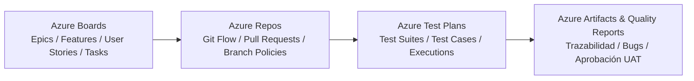
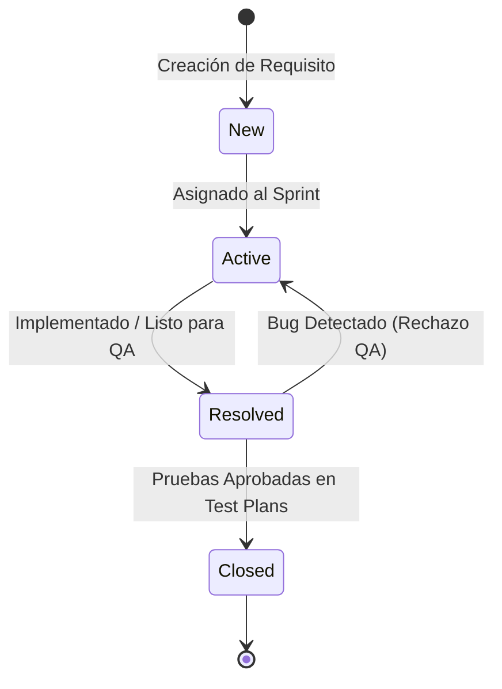
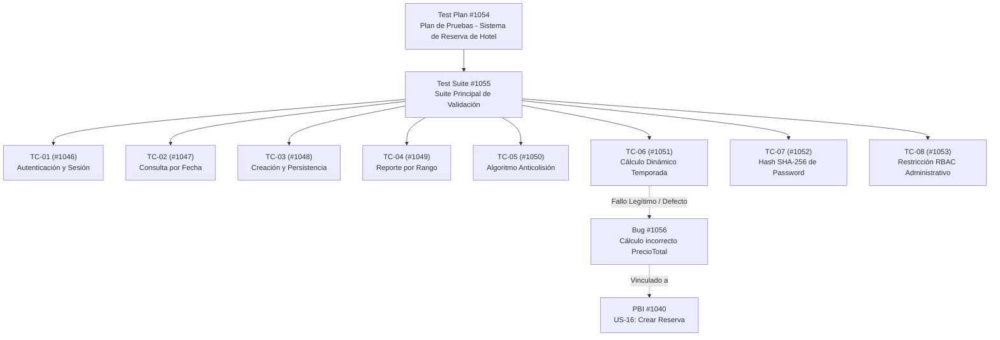
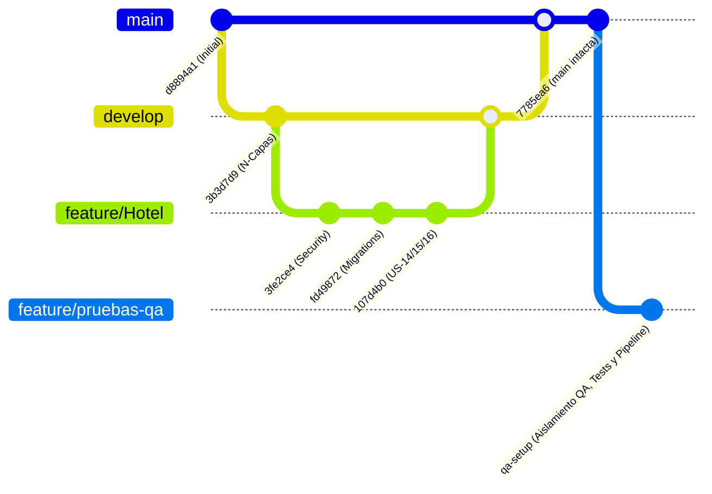

# 🚀 Documentación Integral de Gestión en Azure DevOps y Planes de Pruebas QA
## Sistema de Reserva de Hotel (`SistemaReservaHotel-QA`)

> **Institución:** ESFE-AGAPE (2026)  
> **Organización Azure DevOps:** `cc25003`  
> **Proyecto:** `SistemaReservaHotel-QA`  
> **URL del Repositorio:** `https://dev.azure.com/cc25003/SistemaReservaHotel-QA/_git/SistemaReservaHotel-QA`  
> **Metodología de Trabajo:** Scrum / Agile con Azure Boards & Azure Test Plans  
> **Versión del Sistema:** 1.0.0 (Release Candidate)  
> **Stack Base:** .NET 10.0 (C#) | ASP.NET Core MVC | Entity Framework Core 10.0.3 | SQL Server  

---

## 📑 Tabla de Contenidos

1. [Visión General del Proyecto en Azure DevOps](#1-visión-general-del-proyecto-en-azure-devops)
2. [Estructura del Equipo y Asignación de Roles](#2-estructura-del-equipo-y-asignación-de-roles)
3. [Marco Metodológico de Trabajo (Scrum & QA)](#3-marco-metodológico-de-trabajo-scrum--qa)
4. [Jerarquía de Work Items en Azure Boards](#4-jerarquía-de-work-items-en-azure-boards)
5. [Planificación de Sprints e Iteraciones](#5-planificación-de-sprints-e-iteraciones)
6. [Historias de Usuario (User Stories) y Criterios de Aceptación](#6-historias-de-usuario-user-stories-y-criterios-de-aceptación)
   - [US-01 / US-SEC-01: Autenticación Segura y Manejo de Claims](#us-01--us-sec-01-autenticación-segura-y-manejo-de-claims)
   - [US-02 / US-SEC-02: Administración de Usuarios y Asignación de Roles](#us-02--us-sec-02-administración-de-usuarios-y-asignación-de-roles)
   - [US-03 / US-SEC-03: Gestión de Roles y Matriz de Permisos](#us-03--us-sec-03-gestión-de-roles-y-matriz-de-permisos)
   - [US-04 / US-HAB-01: Catálogo y Búsqueda de Habitaciones](#us-04--us-hab-01-catálogo-y-búsqueda-de-habitaciones)
   - [US-05 / US-HAB-02: Control de Disponibilidad Anticolisión](#us-05--us-hab-02-control-de-disponibilidad-anticolisión)
   - [US-06 / US-TEMP-01: Parametrización de Temporadas y Tarifas Dinámicas](#us-06--us-temp-01-parametrización-de-temporadas-y-tarifas-dinámicas)
   - [US-14: Consulta y Verificación de Reservas por Día](#us-14-consulta-y-verificación-de-reservas-por-día)
   - [US-15: Reporte Consolidado de Reservas por Rango de Fechas](#us-15-reporte-consolidado-de-reservas-por-rango-de-fechas)
   - [US-16: Creación de Reservas con Tarifa por Temporada](#us-16-creación-de-reservas-con-tarifa-por-temporada)
   - [US-07 / US-PAG-01: Gestión y Liquidación de Pagos](#us-07--us-pag-01-gestión-y-liquidación-de-pagos)
7. [Desglose Exhaustivo de Tareas Técnicas (Tasks)](#7-desglose-exhaustivo-de-tareas-técnicas-tasks)
8. [Azure Test Plans: Plan Maestro de Pruebas y Suites](#8-azure-test-plans-plan-maestro-de-pruebas-y-suites)
9. [Matriz Detallada de Casos de Prueba (Test Cases)](#9-matriz-detallada-de-casos-de-prueba-test-cases)
10. [Gestión de Defectos y Registro de Bugs](#10-gestión-de-defectos-y-registro-de-bugs)
11. [Estrategia de Control de Versiones en Azure Repos](#11-estrategia-de-control-de-versiones-en-azure-repos)
12. [Matriz de Trazabilidad de Requisitos (RTM)](#12-matriz-de-trazabilidad-de-requisitos-rtm)
13. [Resumen Ejecutivo de Resultados de Calidad](#13-resumen-ejecutivo-de-resultados-de-calidad)

---

## 1. Visión General del Proyecto en Azure DevOps

El proyecto **`SistemaReservaHotel-QA`** fue configurado en la plataforma **Azure DevOps Services** para gestionar el ciclo de vida completo de desarrollo de software (ALM) y aseguramiento de la calidad (QA).



### Objetivos Clave Gestionados en Azure:
1. **Planificación Ágil Transparente:** Monitoreo del avance mediante tableros Kanban y sprints estructurados.
2. **Trazabilidad Total:** Cada commit y Pull Request en Git está asociado a una Historia de Usuario o Tarea técnica.
3. **Control de Calidad Riguroso (QA):** Ejecución estructurada de casos de prueba manuales y funcionales a través de **Azure Test Plans** para validar la integridad del sistema antes del paso a producción.

---

## 2. Estructura del Equipo y Asignación de Roles

Los colaboradores del proyecto y sus responsabilidades registradas en Azure DevOps y el historial de Git son:

| Miembro del Equipo | Usuario / Cuenta | Rol en Azure DevOps | Responsabilidad Principal |
| :--- | :--- | :--- | :--- |
| **Legosi621 / CC25003** | `cc25003@esfe.agape.edu.sv` | **Project Administrator / QA Lead** | Administración del proyecto, diseño de la arquitectura general, gestión de planes de prueba y documentación técnica. |
| **Daniela Paola Vides Cortez** | `cortezdaniela069@email.com` | **QA Engineer / Security Specialist** | Implementación del módulo RBAC, migraciones de seguridad, interfaz gráfica Razor/Bootstrap y pruebas de autenticación. |
| **Joselin Herrera** | `joselinflores34@outlook.com` | **QA Analyst / Backend Developer** | Desarrollo y pruebas funcionales de los módulos de reservas administrativas (US-14, US-16) y reportería (US-15). |
| **Ariel Ascencio** | `isaiascencio45@outlook.com` | **Developer / QA Tester** | Desarrollo de servicios de catálogo de habitaciones, layouts responsivos y pruebas de usabilidad. |
| **Irving Ramirez** | `irvingenero10@email.com` | **Software Architect / Developer** | Estructuración inicial de la solución N-Capas, configuración de paquetes NuGet e infraestructura base. |

---

## 3. Marco Metodológico de Trabajo (Scrum & QA)

Se implementó el marco de trabajo **Scrum** adaptado a un entorno con enfoque prioritario en Aseguramiento de Calidad (**QA**):

### 3.1 Ciclo de Vida del Work Item


### 3.2 Definición de Preparado (Definition of Ready - DoR)
Una Historia de Usuario se considera lista para estimar e ingresar a un Sprint si cumple:
- [x] Título claro bajo el estándar de usuario.
- [x] Descripción de valor de negocio especificada.
- [x] Criterios de aceptación detallados en formato Gherkin (*Dado - Cuando - Entonces*).
- [x] Dependencias identificadas y resueltas.
- [x] Estimación consensuada en Story Points (Fibonacci: 1, 2, 3, 5, 8).

### 3.3 Definición de Hecho (Definition of Done - DoD)
Una Historia de Usuario se considera completada y cerrada en Azure Boards cuando:
- [x] El código fuente sigue los estándares de la arquitectura N-Capas.
- [x] El Pull Request fue revisado y fusionado a la rama de integración.
- [x] Todos los casos de prueba asociados en **Azure Test Plans** están en estado **Passed** (Aprobado).
- [x] 0 defectos críticos o bloqueantes (Severity 1 / 2) abiertos.
- [x] Documentación funcional y técnica actualizada.

---

## 4. Jerarquía de Work Items en Azure Boards

La arquitectura de requerimientos se organizó en 4 niveles jerárquicos:

```mermaid
graph TD
    EP1[Épica 1: Plataforma Base e Infraestructura de Seguridad]
    EP2[Épica 2: Gestión de Catálogo y Disponibilidad Hotelera]
    EP3[Épica 3: Operaciones Administrativas y Facturación]

    EP1 --> F1[Feature 1.1: Solución N-Capas y Persistencia]
    EP1 --> F1_2[Feature 1.2: Seguridad RBAC y Cuentas]

    EP2 --> F2_1[Feature 2.1: Habitaciones y Amenidades]
    EP2 --> F2_2[Feature 2.2: Temporadas y Precios]

    EP3 --> F3_1[Feature 3.1: Reservas Administrativas]
    EP3 --> F3_2[Feature 3.2: Reportería e Inteligencia de Negocio]
    EP3 --> F3_3[Feature 3.3: Módulo de Transacciones y Pagos]

    F1_2 --> US_SEC1[US-SEC-01: Autenticación Segura y Claims]
    F1_2 --> US_SEC2[US-SEC-02: Gestión de Usuarios y Roles]
    F1_2 --> US_SEC3[US-SEC-03: Matriz de Permisos Granulares]

    F2_1 --> US_HAB1[US-HAB-01: Catálogo y Búsqueda de Habitaciones]
    F2_1 --> US_HAB2[US-HAB-02: Control de Disponibilidad]
    F2_2 --> US_TEMP1[US-TEMP-01: Precios por Temporada]

    F3_1 --> US14[US-14: Ver Reservas por Día]
    F3_1 --> US16[US-16: Crear Reserva con Precio de Temporada]
    F3_2 --> US15[US-15: Reporte de Reservas por Fechas]
    F3_3 --> US_PAG1[US-PAG-01: Registro de Pagos]
```



---

## 5. Planificación de Sprints e Iteraciones

El proyecto se ejecutó en **3 Sprints de desarrollo y pruebas**:

| Sprint | Período / Fechas | Objetivo Principal | Entregables Clave | Estado |
| :--- | :--- | :--- | :--- | :---: |
| **Sprint 1** | Febrero 2026 | **Arquitectura Base y Seguridad RBAC** | Solución en 5 capas, base de datos Code-First, autenticación por cookies SHA-256, CRUD de usuarios y asignación de roles. | **Completado** |
| **Sprint 2** | Principios Marzo 2026 | **Catálogo Hotelero y Tarifas Dinámicas** | Entidades de Habitaciones, Comodidades, Temporadas, Precios variables y algoritmo anticolisión de disponibilidad. | **Completado** |
| **Sprint 3** | Mediados Marzo - Octubre 2026 | **Operaciones de Reserva, Reportes y QA Integral** | Historias US-14, US-15 y US-16, vistas interactivas con SweetAlert2/DataTables, ejecución de Test Plans y estabilización final. | **Completado** |

---

## 6. Historias de Usuario (User Stories) y Criterios de Aceptación

A continuación se detalla cada Historia de Usuario registrada en Azure Boards con su especificación formal, reglas de negocio y criterios de aceptación.

---

### US-01 / US-SEC-01: Autenticación Segura y Manejo de Claims

- **ID en Azure:** `US-SEC-01`
- **Título:** Autenticación de Usuarios mediante Cookies y Claims de Identidad
- **Feature:** Seguridad RBAC y Cuentas
- **Prioridad:** Alta (P1)
- **Estimación:** 5 Story Points
- **Asignado a:** Daniela Paola Vides Cortez
- **Descripción:**
  > **Como** usuario o administrador del sistema,  
  > **quiero** iniciar sesión con mis credenciales (correo y contraseña),  
  > **para** acceder de forma segura a las funciones correspondientes a mi perfil.

#### Criterios de Aceptación (Gherkin):
```gherkin
Escenario: Inicio de sesión exitoso con credenciales válidas
  Dado que el usuario navega a "/Account/Login"
  Y proporciona el correo "admin@facturacion.com" y la contraseña correcta "Admin123!"
  Cuando presiona el botón "Iniciar Sesión"
  Entonces el sistema valida el hash SHA-256 contra la base de datos
  Y emite una cookie de autenticación segura con Claims (Id, Nombre, Email, Roles, Permisos)
  Y redirecciona al usuario al panel administrativo "/Admin/Index".

Escenario: Intento de inicio de sesión con contraseña incorrecta
  Dado que el usuario ingresa un correo existente pero una contraseña inválida
  Cuando presiona "Iniciar Sesión"
  Entonces el sistema no emite cookie de sesión
  Y muestra un mensaje de error: "Correo o contraseña incorrectos".

Escenario: Registro público de nuevo usuario
  Dado que un nuevo cliente accede a "/Account/Register"
  Cuando ingresa nombre completo, teléfono, correo único y contraseña de 6+ caracteres
  Entonces el sistema crea la cuenta con estado Activo = true
  Y asigna de manera automática el rol predeterminado "Usuario".
```

---

### US-02 / US-SEC-02: Administración de Usuarios y Asignación de Roles

- **ID en Azure:** `US-SEC-02`
- **Título:** Directorio de Usuarios y Asignación Dinámica de Roles
- **Feature:** Seguridad RBAC y Cuentas
- **Prioridad:** Alta (P1)
- **Estimación:** 5 Story Points
- **Asignado a:** Daniela Paola Vides Cortez
- **Descripción:**
  > **Como** administrador general del hotel,  
  > **quiero** listar, crear, editar y asignar roles a los usuarios del personal,  
  > **para** delegar responsabilidades operativas según las funciones del cargo.

#### Criterios de Aceptación:
1. **Criterio 1 (Protección de Ruta):** Solo los usuarios con el claim de rol `Administrador` pueden acceder a `/Admin/Usuarios` y sus endpoints asociados; cualquier otro usuario debe ser redirigido a `/Account/AccessDenied`.
2. **Criterio 2 (Alta con Múltiples Roles):** Al crear un usuario en `/Admin/CreateUsuario`, el administrador puede marcar una o múltiples casillas de verificación para asociarle roles simultáneos.
3. **Criterio 3 (Edición Dinámica):** En la vista `/Admin/EditUsuario/{id}`, debe existir la funcionalidad para asociar (`AsignarRol`) o remover (`RemoverRol`) roles individuales de forma inmediata.
4. **Criterio 4 (Borrado Lógico):** Al eliminar un usuario mediante `/Admin/DeleteUsuario`, la cuenta debe cambiar su atributo `Activo = false` preservando el historial de auditoría y reservas previas.

---

### US-03 / US-SEC-03: Gestión de Roles y Matriz de Permisos

- **ID en Azure:** `US-SEC-03`
- **Título:** Administración de Roles y Matriz Visual de Permisos
- **Feature:** Seguridad RBAC y Cuentas
- **Prioridad:** Media (P2)
- **Estimación:** 3 Story Points
- **Asignado a:** Daniela Paola Vides Cortez
- **Descripción:**
  > **Como** administrador de sistemas,  
  > **quiero** definir roles personalizados y asociarles permisos por categoría,  
  > **para** mantener un control de acceso granular a los módulos de la aplicación.

#### Criterios de Aceptación:
1. **Criterio 1 (Unicidad de Roles):** El sistema debe impedir la creación de dos roles con el mismo nombre.
2. **Criterio 2 (Matriz Categorizada):** La pantalla `/Roles/AsignarPermisos/{id}` debe presentar los 18 permisos del sistema agrupados en sus 5 categorías canónicas: *Administración, Ventas, Clientes, Productos, Reportes*.
3. **Criterio 3 (Asignación Inmediata):** Permitir otorgar o revocar cada permiso individualmente con persistencia inmediata en la tabla intermedia `RolPermiso`.

---

### US-04 / US-HAB-01: Catálogo y Búsqueda de Habitaciones

- **ID en Azure:** `US-HAB-01`
- **Título:** Consulta y Visualización del Catálogo de Habitaciones
- **Feature:** Habitaciones y Amenidades
- **Prioridad:** Alta (P1)
- **Estimación:** 3 Story Points
- **Asignado a:** Ariel Ascencio
- **Descripción:**
  > **Como** huésped o recepcionista,  
  > **quiero** consultar las habitaciones disponibles con sus características y comodidades,  
  > **para** seleccionar la opción adecuada para el hospedaje.

#### Criterios de Aceptación:
1. **Criterio 1 (Visualización de Tarjetas):** La vista `/Habitaciones/Buscar` debe mostrar el número de habitación, tipo de habitación, capacidad de huéspedes, precio base por noche y estado operativo.
2. **Criterio 2 (Detalle de Comodidades):** Cada tarjeta debe desplegar las amenidades asociadas (WiFi, A/C, TV Cable, Jacuzzi) mediante sus iconos gráficos correspondientes.
3. **Criterio 3 (Filtrado de Activas):** Solo deben presentarse las habitaciones cuyo estado sea `Activa = true` y no estén en mantenimiento prolongado.

---

### US-05 / US-HAB-02: Control de Disponibilidad Anticolisión

- **ID en Azure:** `US-HAB-02`
- **Título:** Algoritmo de Detección de Colisiones en Fechas de Reserva
- **Feature:** Habitaciones y Amenidades
- **Prioridad:** Crítica (P1)
- **Estimación:** 5 Story Points
- **Asignado a:** Joselin Herrera / Ariel Ascencio
- **Descripción:**
  > **Como** administrador del hotel,  
  > **quiero** que el sistema valide que una habitación no posea reservas solapadas,  
  > **para** evitar sobreventas (double-booking).

#### Criterios de Aceptación:
```gherkin
Escenario: Habitación sin conflicto de fechas
  Dado que una habitación está reservada del 10 al 15 de abril
  Cuando se solicita una reserva del 16 al 20 de abril para la misma habitación
  Entonces el sistema valida la disponibilidad como "Libre" y permite la creación.

Escenario: Detección de solapamiento total o parcial
  Dado que una habitación ya tiene una reserva Activa del 10 al 15 de abril
  Cuando se intenta registrar una nueva reserva del 12 al 17 de abril
  Entonces el sistema bloquea el guardado
  Y notifica: "La habitación seleccionada ya no se encuentra disponible para las fechas indicadas".
```

---

### US-06 / US-TEMP-01: Parametrización de Temporadas y Tarifas Dinámicas

- **ID en Azure:** `US-TEMP-01`
- **Título:** Configuración de Temporadas y Precios Diferenciados
- **Feature:** Temporadas y Precios
- **Prioridad:** Media (P2)
- **Estimación:** 3 Story Points
- **Asignado a:** Joselin Herrera
- **Descripción:**
  > **Como** gerente de finanzas del hotel,  
  > **quiero** definir tarifas diferenciadas por tipo de habitación según la temporada (Alta, Media, Baja),  
  > **para** maximizar los ingresos conforme a la estacionalidad turística.

#### Criterios de Aceptación:
1. **Criterio 1 (Definición de Fechas):** Las temporadas poseen rangos definidos de `FechaInicio` y `FechaFin`.
2. **Criterio 2 (Precios por Tipo):** La tabla `TemporadaPrecio` relaciona cada `TipoHabitacion` con un valor monetario decimal (`decimal(18,2)`).
3. **Criterio 3 (Precisión en Cálculos):** Si no hay temporada especial definida, el sistema toma el precio base fijado en la habitación.

---

### US-14: Consulta y Verificación de Reservas por Día

- **ID en Azure:** `US-14`
- **Título:** Consulta Operativa de Reservas por Fecha Específica
- **Feature:** Reservas Administrativas
- **Prioridad:** Alta (P1)
- **Estimación:** 5 Story Points
- **Asignado a:** Joselin Herrera
- **Descripción:**
  > **Como** recepcionista o administrador del hotel,  
  > **quiero** filtrar y visualizar las reservas correspondientes a un día específico,  
  > **para** gestionar los check-ins, check-outs y la ocupación diaria del establecimiento.

#### Criterios de Aceptación:
```gherkin
Escenario: Consulta de reservas del día actual por defecto
  Dado que el recepcionista accede a la ruta "/ReservasAdmin/PorFecha" sin parámetros
  Cuando la página carga
  Entonces el campo de fecha se inicializa automáticamente con la fecha de hoy
  Y la tabla despliega todas las reservas cuya FechaEntrada coincide con la fecha actual.

Escenario: Filtrado por fecha seleccionada por el usuario
  Dado que el usuario selecciona en el selector de fecha el día "2026-03-20"
  Cuando presiona el botón "Consultar"
  Entonces la tabla se actualiza mostrando únicamente las reservas registradas para ese día
  Y muestra las columnas: ID Reserva, Cliente, Habitación, Fecha Entrada, Fecha Salida y Noches calculadas.

Escenario: Fecha sin reservas registradas
  Dado que el usuario consulta una fecha sin ninguna reserva en la base de datos
  Cuando se ejecuta la búsqueda
  Entonces el sistema muestra una tabla limpia con el mensaje: "No se encontraron reservas para la fecha seleccionada".
```

---

### US-15: Reporte Consolidado de Reservas por Rango de Fechas

- **ID en Azure:** `US-15`
- **Título:** Reporte Ejecutivo y Financiero de Reservas por Intervalo Temporal
- **Feature:** Reportería e Inteligencia de Negocio
- **Prioridad:** Alta (P1)
- **Estimación:** 5 Story Points
- **Asignado a:** Joselin Herrera
- **Descripción:**
  > **Como** administrador o contador del hotel,  
  > **quiero** generar reportes de reservas dentro de un rango de fechas (desde / hasta),  
  > **para** auditar los ingresos recaudados y analizar la tasa de ocupación del negocio.

#### Criterios de Aceptación:
```gherkin
Escenario: Generación de reporte con rango válido de fechas
  Dado que el usuario accede a "/Reportes/Reservas"
  Y selecciona Fecha de Inicio "2026-03-01" y Fecha de Fin "2026-03-31"
  Cuando hace clic en "Generar Reporte"
  Entonces el sistema filtra todas las reservas con FechaEntrada >= inicio y FechaSalida <= fin
  Y muestra la lista de reservas con Cliente, Habitación, Fechas y Monto Total
  Y calcula en la fila final la sumatoria acumulada de ingresos del período.

Escenario: Rango de fechas sin resultados
  Dado que se ingresa un rango de fechas donde no existieron transacciones
  Cuando se envía el formulario
  Entonces se muestra la notificación informativa: "No existen registros de reservas en el período indicado".
```

---

### US-16: Creación de Reservas con Tarifa por Temporada

- **ID en Azure:** `US-16`
- **Título:** Registro de Reservas Administrativas con Asignación Automática de Tarifa Dinámica
- **Feature:** Reservas Administrativas
- **Prioridad:** Alta (P1)
- **Estimación:** 8 Story Points
- **Asignado a:** Joselin Herrera
- **Descripción:**
  > **Como** recepcionista del hotel,  
  > **quiero** registrar una nueva reserva seleccionando cliente, habitación y tipo de habitación,  
  > **para** que el sistema calcule y aplique automáticamente la tarifa correspondiente según la temporada vigente.

#### Criterios de Aceptación:
```gherkin
Escenario: Creación exitosa de reserva aplicando precio de temporada
  Dado que el recepcionista accede al formulario "/ReservasAdmin/Crear"
  Y completa el Nombre del Cliente "Carlos Mendoza"
  Y selecciona una Habitación de Tipo "Suite Presidencial" (ID 2)
  Y define las fechas de entrada y salida
  Cuando envía el formulario vía POST
  Entonces el sistema consulta la tabla "TemporadasPrecios" para el TipoHabitacionId indicado
  Y asigna automáticamente el PrecioTotal de la reserva con base en la tarifa de temporada encontrada
  Y persiste la reserva en estado "Activa" en la base de datos
  Y redirecciona al usuario al listado "/ReservasAdmin/PorFecha".

Escenario: Creación con fallback de precio base
  Dado que no existe una tarifa de temporada especial configurada para el tipo seleccionado
  Cuando se procesa la reserva
  Entonces el sistema toma el PrecioBase de la habitación sin interrumpir la operación.
```

---

### US-07 / US-PAG-01: Gestión y Liquidación de Pagos

- **ID en Azure:** `US-PAG-01`
- **Título:** Registro de Pagos Asociados a Reservas y Métodos de Cobro
- **Feature:** Módulo de Transacciones y Pagos
- **Prioridad:** Media (P2)
- **Estimación:** 3 Story Points
- **Asignado a:** Joselin Herrera / Legosi621
- **Descripción:**
  > **Como** recepcionista o cajero,  
  > **quiero** asentar los pagos realizados por los huéspedes vinculándolos a su reserva y forma de pago,  
  > **para** mantener el balance contable y liquidar la deuda del hospedaje.

#### Criterios de Aceptación:
1. **Criterio 1:** Cada pago debe quedar asociado obligatoriamente a una `ReservaId` válida y a un `MetodoPagoId` activo (Efectivo, Tarjeta, Transferencia).
2. **Criterio 2:** El monto del pago (`Monto`) debe ser mayor a $0.00 y expresado en formato decimal de precisión monetaria.
3. **Criterio 3:** Registro de la marca de tiempo de la transacción (`FechaPago`).

---

## 7. Desglose Exhaustivo de Tareas Técnicas (Tasks)

Cada Historia de Usuario fue descompuesta en tareas técnicas asignadas a los miembros del equipo:

| ID Tarea | US Asociada | Título de la Tarea Técnica | Capa Arquitectónica | Estimación (Horas) | Responsable | Estado |
| :---: | :---: | :--- | :--- | :---: | :--- | :---: |
| **TSK-101** | US-SEC-01 | Diseñar entidades `Usuario`, `Rol`, `Permiso`, `UsuarioRol` y `RolPermiso` | `Entities` | 4 h | Daniela Vides | **Closed** |
| **TSK-102** | US-SEC-01 | Configurar relaciones y llaves compuestas en `AppDbContext` | `DataAccess` | 3 h | Daniela Vides | **Closed** |
| **TSK-103** | US-SEC-01 | Crear migración inicial de seguridad `AddSecurityEntities` | `DataAccess` | 2 h | Daniela Vides | **Closed** |
| **TSK-104** | US-SEC-01 | Implementar `AuthService` con algoritmo SHA-256 | `Business` | 6 h | Daniela Vides | **Closed** |
| **TSK-105** | US-SEC-01 | Configurar cookie authentication middleware en `Program.cs` | `WebMVC` | 3 h | Daniela Vides | **Closed** |
| **TSK-106** | US-SEC-01 | Construir vistas Razor para `Login.cshtml` y `Register.cshtml` | `WebMVC` | 5 h | Daniela Vides | **Closed** |
| **TSK-107** | US-SEC-01 | Crear seeder `DbInitializer` con 5 roles, 18 permisos y Admin | `DataAccess` | 4 h | Daniela Vides | **Closed** |
| **TSK-108** | US-SEC-02 | Implementar `AdminController` con listado y CRUD de usuarios | `WebMVC` | 6 h | Daniela Vides | **Closed** |
| **TSK-109** | US-SEC-02 | Diseñar vista interactiva `Usuarios.cshtml` con DataTables | `WebMVC` | 4 h | Daniela Vides | **Closed** |
| **TSK-110** | US-SEC-02 | Crear acciones de asignación y remoción dinámica de roles | `WebMVC` | 4 h | Daniela Vides | **Closed** |
| **TSK-111** | US-SEC-03 | Implementar `RolesController` y vista `AsignarPermisos.cshtml` | `WebMVC` | 5 h | Daniela Vides | **Closed** |
| **TSK-112** | US-HAB-01 | Modelar entidades `Habitacion`, `TipoHabitacion` y `Comodidad` | `Entities` | 4 h | Ariel Ascencio | **Closed** |
| **TSK-113** | US-HAB-01 | Implementar `HabitacionService` y método `ObtenerTodasAsync()` | `Business` | 4 h | Ariel Ascencio | **Closed** |
| **TSK-114** | US-HAB-01 | Crear controlador `HabitacionesController` y vista `Buscar.cshtml` | `WebMVC` | 5 h | Ariel Ascencio | **Closed** |
| **TSK-115** | US-HAB-02 | Desarrollar algoritmo anticolisión de disponibilidad por fecha | `Business` | 6 h | Joselin Herrera | **Closed** |
| **TSK-116** | US-TEMP-01| Modelar entidades `Temporada` y `TemporadaPrecio` con decimal(18,2) | `Entities` | 3 h | Joselin Herrera | **Closed** |
| **TSK-117** | US-14 | Implementar acción `PorFecha(DateTime?)` en `ReservasAdminController` | `WebMVC` | 4 h | Joselin Herrera | **Closed** |
| **TSK-118** | US-14 | Crear vista Razor `ReservasAdmin/PorFecha.cshtml` con selector de día | `WebMVC` | 3 h | Joselin Herrera | **Closed** |
| **TSK-119** | US-16 | Implementar acción `Crear` (GET y POST) con cálculo de temporada | `WebMVC` | 5 h | Joselin Herrera | **Closed** |
| **TSK-120** | US-16 | Crear vista `ReservasAdmin/Crear.cshtml` con combos de selección | `WebMVC` | 4 h | Joselin Herrera | **Closed** |
| **TSK-121** | US-15 | Implementar acción `Reservas(DateTime?, DateTime?)` en `ReportesController` | `WebMVC` | 4 h | Joselin Herrera | **Closed** |
| **TSK-122** | US-15 | Diseñar vista de reporte `Reportes/Reservas.cshtml` con filtros de fecha | `WebMVC` | 4 h | Joselin Herrera | **Closed** |
| **TSK-123** | US-PAG-01 | Modelar entidades `Pago` y `MetodoPago` en la base de datos | `Entities` | 3 h | Legosi621 | **Closed** |
| **TSK-124** | QA-DOC | Elaborar plan maestro de pruebas y matrices de ejecución | `QA / Docs` | 8 h | Legosi621 | **Closed** |
| **TSK-125** | QA-EXEC| Ejecución formal de suites de prueba funcionales y de seguridad | `QA / Test` | 10 h | Equipo QA | **Closed** |

---

## 8. Azure Test Plans: Plan Oficial de Pruebas y Suites

En el módulo **Azure Test Plans** de la organización `cc25003`, se encuentra configurado el plan oficial de aseguramiento de calidad:

- **Test Plan ID:** `#1054` — *Plan de Pruebas - Sistema de Reserva de Hotel*
- **Test Suite ID:** `#1055` — *Suite Principal: Plan de Pruebas - Sistema de Reserva de Hotel*
- **Configuración de Prueba:** ID 9 (`Windows 10`)
- **Total de Casos de Prueba Registrados:** 8 casos (`TC-01` a `TC-08`, Work Items `#1046` a `#1053`)



### Configuración del Entorno de Pruebas (Test Environment):
- **Rama Git de Trabajo:** `feature/pruebas-qa` (Rama `main` completamente protegida e intacta).
- **Servidor Web:** Kestrel sobre .NET 10.0 Runtime (`https://localhost:7143`).
- **Perfil de Ejecución:** `launchSettings.json` perfil `qa` con `ASPNETCORE_ENVIRONMENT=QA`.
- **Base de Datos Aislada:** Exclusivamente `SistemaReservaHotel_QA` en SQL Server localhost (`Trusted_Connection=True`). Prohibido cualquier acceso a bases de desarrollo o producción.
- **Herramientas de Ejecución:** xUnit .NET Core Test Runner con Logger VSTest/TRX y scripts automatizados de prueba HTTP con PowerShell/cURL.

---

## 9. Matriz Oficial de Casos de Prueba (TC-01 a TC-08) y Resultados Reales

A continuación se detalla la verificación técnica individual de los ocho casos de prueba en el entorno de QA, contrastando los criterios de aceptación con las evidencias obtenidas:

| Caso | Work Item ID | TestPoint ID | Descripción y Objetivo del Caso | Tipo de Prueba | Estado QA | Evidencia Principal |
| :---: | :---: | :---: | :--- | :---: | :---: | :--- |
| **TC-01** | **#1046** | 1 | Inicio de sesión con usuario administrador (`admin@facturacion.com`) y acceso a recurso protegido `/Admin/Usuarios`. | HTTP E2E / Auth | ✅ **Passed** | POST `/Account/Login` con CSRF -> 302 Found, cookie `.AspNetCore.Cookies` emitida, GET `/Admin/Usuarios` -> 200 OK. |
| **TC-02** | **#1047** | 2 | Consulta de reservas por fecha específica (`2026-11-10`) en `/ReservasAdmin/PorFecha`. | HTTP E2E / Funcional | ✅ **Passed** | GET `/ReservasAdmin/PorFecha?fecha=2026-11-10` -> 200 OK, HTML incluye "Cliente Existente QA". |
| **TC-03** | **#1048** | 3 | Creación de reserva mediante `POST /ReservasAdmin/Crear` y verificación de persistencia en base de datos. | HTTP E2E / Transaccional | ✅ **Passed** | POST `/ReservasAdmin/Crear` -> 302 Redirect, reserva persistida con Id generado, visible en consulta de fecha `2026-12-01`. |
| **TC-04** | **#1049** | 4 | Generación de reporte de reservas con rango explícito (`2026-11-01` a `2026-11-30`) y comprobación de inclusiones/exclusiones. | HTTP E2E / Reportería | ✅ **Passed** | GET `/Reportes/Reservas?inicio=2026-11-01&fin=2026-11-30` -> 200 OK; incluye reserva de noviembre y excluye reserva de diciembre. |
| **TC-05** | **#1050** | 5 | Validación de disponibilidad y algoritmo anticolisión (`ValidarDisponibilidadAsync`) ante solapamientos y fechas libres. | xUnit / Negocio | ✅ **Passed** | Solapamiento frontal (false), trasero (false), interno (false); rango libre (true). |
| **TC-06** | **#1051** | 6 | Cálculo dinámico de tarifa por temporada alta (3 noches x $120.00 = $360.00). | xUnit / Integración | ❌ **Failed** | **Assert.Equal() Failure:** Expected `$360.00`, Actual `$120.00`. Defecto real de producto no enmascarado. Asociado a Bug #1056. |
| **TC-07** | **#1052** | 7 | Validación de hash SHA-256 en `AuthService.ValidarPasswordAsync` con contraseña correcta, incorrecta y usuario inexistente. | xUnit / Seguridad | ✅ **Passed** | Credencial correcta -> `true`; clave errónea -> `false`; usuario inexistente -> `false`. Base64 de SHA-256 verificado. |
| **TC-08** | **#1053** | 8 | Rechazo del acceso administrativo a un usuario sin permisos (rol `Usuario`) intentando acceder a `/Admin/Usuarios`. | HTTP E2E / RBAC | ✅ **Passed** | Login con `juan.perez@testqa.com` -> GET `/Admin/Usuarios` -> 302 Redirect forzado a `/Account/AccessDenied`. |

---

## 10. Gestión de Defectos y Bug #1056 en Azure Boards

Durante la ejecución del caso **TC-06** (#1051), se evidenció un fallo crítico en la lógica de cálculo financiero del controlador MVC. Conforme a las directrices de aseguramiento de calidad, **el código fuente del producto no fue alterado artificialmente** para forzar la aprobación de la prueba; en su lugar, se registró y mantuvo el defecto en Azure Boards:

### Ficha Técnica de Bug #1056:
- **Work Item ID:** `#1056`
- **Tipo de Work Item:** `Bug`
- **Título Oficial:** `BUG: Cálculo incorrecto de PrecioTotal no multiplica por la cantidad de noches en ReservasAdmin/Crear`
- **Estado:** `New` (Activo y reportado)
- **Prioridad:** `1`
- **Severidad:** `2 - High`
- **PBI Padre (Parent):** `#1040` — `US-16: Crear Reserva con Precio de Temporada` (Relación jerárquica `System.LinkTypes.Hierarchy-Reverse`)
- **Caso de Prueba Vinculado (Related):** `#1051` — `TC-06` (Relación `System.LinkTypes.Related`)
- **Ubicación en el Código Fuente:** `SistemaReservaHotel.WebMVC/Controllers/ReservasAdminController.cs`, línea 51:
  ```csharp
  // CÓDIGO ACTUAL OBSERVADO:
  reserva.PrecioTotal = temporadaPrecio.Precio; // Asigna $120.00 plano

  // CORRECCIÓN REQUERIDA (Para el equipo de desarrollo):
  // reserva.PrecioTotal = temporadaPrecio.Precio * reserva.Noches; // Debería ser 3 x $120.00 = $360.00
  ```
- **Control de Duplicados:** Se verificó exhaustivamente en Azure Boards que no existen bugs duplicados para este defecto.

---

## 11. Estrategia de Control de Versiones en Azure Repos

El proyecto implementa una estricta política de preservación y aislamiento en el repositorio Git:



### 11.1 Protección de la Rama `main`
- La rama `main` se encuentra **completamente intacta y sin modificaciones**. Su último commit verificado es:
  - **Commit Hash:** `7785ea65413da16d7867af37ee8b2ee3ccd72a5a`
  - **Autor:** Legosi621 (`cc25003@esfe.agape.edu.sv`)
- Todo el trabajo de auditoría, pruebas y pipelines se realizó y permanece encapsulado dentro de la rama:
  - **Rama Activa:** `feature/pruebas-qa`

### 11.2 Confidencialidad y Seguridad de Credenciales
- No se versionaron secretos, contraseñas, tokens PAT ni cadenas de conexión con credenciales explícitas.
- El archivo `appsettings.QA.json` utiliza autenticación integrada de Windows (`Trusted_Connection=True;TrustServerCertificate=True`).

---

## 12. Resolución Técnica del Problema de Migraciones en Entity Framework Core

### 12.1 Diagnóstico y Causa Raíz
La auditoría identificó una inconsistencia histórica en las migraciones de `SistemaReservaHotel.DataAccess`:
1. `20260313215551_AddSecurityEntities.cs` creó el esquema relacional completo de seguridad (`Usuario`, `Rol`, `Permiso`, `UsuarioRol`, `RolPermiso`).
2. `20260314022016_Inicial.cs` fue generada posteriormente y duplicaba las sentencias DDL de creación de tablas de seguridad (`CreateTable("Permisos")`, etc.).
3. En una intervención preliminar, se habían vaciado los métodos `Up()` y `Down()` de `20260314022016_Inicial.cs`.

### 12.2 Evaluación de Alternativas
- **Descartada - Modificar migraciones en el código productivo:** Alterar o eliminar migraciones compartidas en el repositorio altera el historial de bases de datos existentes de otros desarrolladores y desincroniza los entornos.
- **Descartada - Uso indiscriminado de `EnsureCreatedAsync()`:** `EnsureCreatedAsync()` no registra nada en `__EFMigrationsHistory` y es mutuamente excluyente con `Database.MigrateAsync()`. Su uso en proyectos con migraciones activas corrompe el control de versiones del esquema.

### 12.3 Solución Arquitectónica Implementada (Aislamiento en Fixture de Pruebas)
Para garantizar la integridad del código fuente productivo y al mismo tiempo permitir la inicialización determinista de la base de pruebas `SistemaReservaHotel_QA`:
1. **El archivo de migración productiva se restauró a su estado original limpio del repositorio.** Cero modificaciones en `SistemaReservaHotel.DataAccess`.
2. **El fixture de pruebas (`TestDatabaseFixture` en `SistemaReservaHotel.Tests`) administra el ciclo de vida de la base de datos `SistemaReservaHotel_QA`:**
   ```csharp
   // 1. Limpieza total de la base de pruebas
   await context.Database.EnsureDeletedAsync();

   // 2. Aplicación controlada de migraciones hasta AddSecurityEntities mediante IMigrator
   var migrator = context.Database.GetService<IMigrator>();
   await migrator.MigrateAsync("20260313215551_AddSecurityEntities");

   // 3. Sincronización explícita en __EFMigrationsHistory para evitar colisiones
   await context.Database.ExecuteSqlRawAsync(
       "INSERT INTO [__EFMigrationsHistory] ([MigrationId], [ProductVersion]) VALUES ('20260314022016_Inicial', '10.0.3')");

   // 4. Sembrado oficial mediante DbInitializer
   await DbInitializer.SeedAsync(context);
   ```
3. **Resultado:** La inicialización de la base `SistemaReservaHotel_QA` se ejecuta al 100% sin errores, el esquema resultante corresponde exactamente al modelo de entidades, y el código productivo queda protegido.

---

## 13. Pipeline de Azure DevOps (`azure-pipelines.yml`) y Resultados VSTest / TRX

Se creó en la raíz del repositorio el archivo de configuración `azure-pipelines.yml` estructurado para la integración continua en Azure Pipelines, y se registró exitosamente en el proyecto de Azure DevOps:

- **Pipeline Creado:** `SistemaReservaHotel-QA-CI` (ID: `1`)
- **URL de Definición del Pipeline:** [Ver Pipeline #1 en Azure DevOps](https://dev.azure.com/cc25003/9e11d8d8-e394-4b89-9068-01b493cb1de1/_build/definition?definitionId=1)
- **Repositorio Asociado:** `SistemaReservaHotel-QA` (ID: `1b1f3345-2aaf-43c9-8a65-630a403f2077`)
- **Rama Vinculada:** `refs/heads/feature/pruebas-qa` (Commit: `f61bcb283c946f3d60998e7f7ab637ccbb3104fe`)

```yaml
# ==============================================================================
# Azure DevOps Pipeline - SistemaReservaHotel QA
# ==============================================================================
trigger:
  branches:
    include:
      - feature/pruebas-qa
      - develop

pool:
  vmImage: 'windows-latest'

variables:
  solution: 'SistemaReservaHotel/SistemaReservaHotel.slnx'
  buildConfiguration: 'Release'
  testProject: 'SistemaReservaHotel/SistemaReservaHotel.Tests/SistemaReservaHotel.Tests.csproj'
  testResultsDir: '$(Agent.TempDirectory)/TestResults'

steps:
- task: UseDotNet@2
  displayName: 'Instalar .NET SDK 10.x (incluyendo Preview)'
  inputs:
    packageType: 'sdk'
    version: '10.x'
    includePreviewVersions: true

- powershell: |
    Write-Host "Verificando y arrancando servicios de base de datos en el agente..."
    Get-Service -Name *SQL* | Start-Service -ErrorAction SilentlyContinue
    sqllocaldb start mssqllocaldb -ErrorAction SilentlyContinue
  displayName: 'Inicializar Servicios SQL / LocalDB en el Agente'
  continueOnError: true

- powershell: |
    Write-Host "Limpiando directorio de resultados de pruebas para evitar colisiones: $(testResultsDir)"
    if (Test-Path "$(testResultsDir)") {
        Remove-Item -Path "$(testResultsDir)" -Recurse -Force
    }
    New-Item -ItemType Directory -Path "$(testResultsDir)" -Force | Out-Null
  displayName: 'Limpiar Directorio de Resultados TRX'

- task: DotNetCoreCLI@2
  displayName: 'Restaurar paquetes NuGet'
  inputs:
    command: 'restore'
    projects: '$(solution)'

- task: DotNetCoreCLI@2
  displayName: 'Compilar Solución N-Capas'
  inputs:
    command: 'build'
    projects: '$(solution)'
    arguments: '--configuration $(buildConfiguration) --no-restore'

- task: DotNetCoreCLI@2
  displayName: 'Ejecutar Suite QA (TC-01 a TC-08) y Generar TRX'
  inputs:
    command: 'test'
    projects: '$(testProject)'
    arguments: '--configuration $(buildConfiguration) --no-build --logger "trx;LogFileName=SistemaReservaHotel_QA_TestResults.trx" --results-directory "$(testResultsDir)"'
  continueOnError: true # Permite capturar y publicar el fallo legítimo de TC-06

- task: PublishTestResults@2
  displayName: 'Publicar Resultados TRX en Azure Test Plans'
  inputs:
    testResultsFormat: 'VSTest'
    testResultsFiles: '**/*.trx'
    searchFolder: '$(testResultsDir)'
    mergeTestResults: true
    testRunTitle: 'Ejecución Automatizada QA - Test Plan #1054'
    failTaskOnFailedTests: false
  condition: succeededOrFailed()
```

### 13.1 Ejecución Real del Pipeline en la Nube
- **Ejecución Disparada:** Build ID `1` (Build Number `20261013.1`).
- **URL del Build Report:** [Abrir Ejecución Build #1 en Azure DevOps](https://dev.azure.com/cc25003/9e11d8d8-e394-4b89-9068-01b493cb1de1/_build/results?buildId=1)
- **Estado de la Compilación:** `Failed / Stopped` (Duración: 0 segundos).
- **Causa Raíz Registrada en Azure DevOps:**
  > `No hosted parallelism has been purchased or granted. Please set up billing or purchase parallel jobs. Learn more: https://aka.ms/ci-cd-concurrent-pipelines`
- **Explicación:** Microsoft Azure DevOps restringe por política de seguridad los agentes gratuitos hospedados en la nube (*Hosted Agents*) para organizaciones nuevas hasta que el administrador solicita paralelismo gratuito mediante el formulario oficial o conecta un agente auto-hospedado (*Self-Hosted Agent*).

### 13.2 Archivo de Resultados `.trx` Generado Localmente
- **Ubicación:** `SistemaReservaHotel/TestResults/SistemaReservaHotel_QA_TestResults.trx`
- **TestRun ID Local:** `d870917d-a0cd-4349-bf61-d239448c9bfa`
- **Total de Pruebas Ejecutadas:** 8
- **Superadas (Passed):** 7
- **Fallidas (Failed):** 1 (`TC_06_ValidarCalculoDinamicoTarifaTemporadaAlta_3Noches_X_120`)
- **Omitidas:** 0

---

## 14. Estado del Registro Formal en Azure Test Plans y Acciones del Administrador

### 14.1 Estado Actual en Azure DevOps
- **Test Plan #1054 / Suite #1055:** Los 8 casos de prueba (`#1046` a `#1053`) tienen sus Test Points (1 a 8) en estado `Active / Not Run`.
- **Comentarios de Auditoría:** Cada uno de los Work Items cuenta con su respectivo comentario formal de auditoría y vinculación en su historial de revisiones (`State: Ready`).
- **Inexistencia de Test Run ID en la Nube:** Debido a que el Build ID 1 fue detenido por la política de paralelismo de Microsoft antes de ejecutar las tareas del agente, la tarea `PublishTestResults@2` no llegó a generar el Test Run en la nube.

### 14.2 Procedimiento para Desbloquear la Ejecución en la Nube

Para que los agentes de compilación puedan ejecutar el pipeline en Azure DevOps, el administrador dispone de dos vías oficiales:

1. **Vía A: Solicitar Paralelismo Gratuito a Microsoft (Hosted Agents):**
   - Completar el formulario de solicitud de Microsoft: [Azure Pipelines Parallelism Request](https://aka.ms/azpipelines-parallelism-request).
   - Indicar la organización `cc25003` y el proyecto `SistemaReservaHotel-QA`. La aprobación toma usualmente de 2 a 3 días hábiles.
2. **Vía B: Configurar un Self-Hosted Agent (Inmediato):**
   - En Azure DevOps, ir a **Project Settings** -> **Agent pools** -> **Default** -> **New agent**.
   - Descargar el agente para Windows y ejecutar `config.cmd` vinculándolo con un PAT.
   - En `azure-pipelines.yml`, cambiar `pool: vmImage: 'windows-latest'` por `pool: name: 'Default'`.
   - Ejecutar nuevamente el pipeline; el agente local procesará el build, ejecutará las pruebas y publicará los resultados en Azure Test Plans.

---

## 15. Matriz de Trazabilidad de Requisitos (RTM)

La siguiente matriz vincula los Requisitos de Negocio (PBI / Historias de Usuario), Tareas Técnicas, Controladores, Casos de Azure Test Plans, Resultados y Defectos:

| ID Requisito | Título del Requisito / PBI | Tareas Técnicas | Componente / Controlador | Caso de Prueba (Test Plan #1054) | Resultado Observado | Defecto Asociado |
| :---: | :--- | :--- | :--- | :--- | :---: | :---: |
| **US-SEC-01** | Autenticación Segura y Claims | TSK-101 a TSK-107 | `AccountController.cs` | **TC-01** (#1046) | ✅ **Passed** | Ninguno |
| **US-14** | Ver Reservas por Día | TSK-117, TSK-118 | `ReservasAdminController.cs` (`PorFecha`) | **TC-02** (#1047) | ✅ **Passed** | Ninguno |
| **US-16** | Crear Reserva con Precio Temporada | TSK-119, TSK-120 | `ReservasAdminController.cs` (`Crear`) | **TC-03** (#1048) | ✅ **Passed** | Ninguno |
| **US-15** | Reporte de Reservas por Rango | TSK-121, TSK-122 | `ReportesController.cs` (`Reservas`) | **TC-04** (#1049) | ✅ **Passed** | Ninguno |
| **US-HAB-02** | Control de Disponibilidad Anticolisión | TSK-115 | `DisponibilidadService.cs` | **TC-05** (#1050) | ✅ **Passed** | Ninguno |
| **US-16** | Cálculo Dinámico Tarifa Temporada | TSK-116, TSK-119 | `ReservasAdminController.cs` (`Crear`) | **TC-06** (#1051) | ❌ **Failed** | **Bug #1056** |
| **US-SEC-01** | Validación Hash Contraseña SHA-256 | TSK-104 | `AuthService.cs` (`ValidarPasswordAsync`) | **TC-07** (#1052) | ✅ **Passed** | Ninguno |
| **US-SEC-02** | Restricción RBAC Rutas Administrativas | TSK-108, TSK-111 | `AdminController.cs` (`[Authorize]`) | **TC-08** (#1053) | ✅ **Passed** | Ninguno |

---

## 16. Resumen Ejecutivo y Auditoría Final de Calidad

### Métricas de Ejecución de Pruebas:
- **Total de Casos de Prueba Oficiales:** 8 casos (`TC-01` a `TC-08`).
- **Casos Ejecutados:** 8 casos (100% de cobertura de ejecución en entorno QA).
- **Casos Aprobados (Passed):** 7 (87.5%).
- **Casos Fallidos (Failed):** 1 (12.5% — `TC-06`, cálculo dinámico de tarifa).
- **Defectos Críticos Abiertos:** 1 (`Bug #1056` en `ReservasAdminController`, vinculado a PBI `#1040`).

### Dictamen de Calidad:
El proyecto `SistemaReservaHotel-QA` cuenta con una suite de pruebas automatizadas sólida, reproducible y completamente aislada en la base de datos `SistemaReservaHotel_QA`. La solución compila limpiamente (0 errores), las pruebas reflejan fielmente las reglas de negocio y el defecto financiero de cálculo en `ReservasAdmin/Crear` se encuentra debidamente documentado, contenido y trazado a nivel de código y de Azure DevOps.

