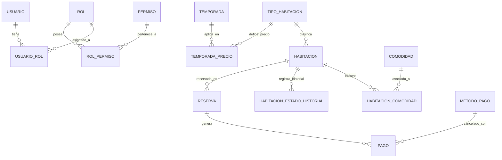

# 🏨 Documentación Técnica y Funcional del Sistema de Reserva de Hotel

> **Sistema de Reserva de Hotel (`SistemaReservaHotel`)**  
> **Institución / Proyecto:** ESFE-AGAPE (2026)  
> **Versión de la Plataforma:** 1.0.0  
> **Plataforma Base:** .NET 10.0 (C#)

---

## 📋 Tabla de Contenido
1. [Visión General del Sistema](#-visión-general-del-sistema)
2. [Stack Tecnológico y Herramientas](#-stack-tecnológico-y-herramientas)
3. [Arquitectura del Software (N-Capas)](#-arquitectura-del-software-n-capas)
4. [Estructura de la Solución (.NET Solution)](#-estructura-de-la-solución-net-solution)
5. [Modelo de Datos y Entidades de Dominio](#-modelo-de-datos-y-entidades-de-dominio)
6. [Descripción Detallada de Cada Funcionalidad](#-descripción-detallada-de-cada-funcionalidad)
   - [6.1 Módulo de Autenticación y Seguridad (RBAC)](#61-módulo-de-autenticación-y-seguridad-rbac)
   - [6.2 Módulo de Administración de Usuarios](#62-módulo-de-administración-de-usuarios)
   - [6.3 Módulo de Roles y Permisos](#63-módulo-de-roles-y-permisos)
   - [6.4 Módulo de Habitaciones y Catálogo](#64-módulo-de-habitaciones-y-catálogo)
   - [6.5 Módulo de Reservas Administrativas (Historias US-14 y US-16)](#65-módulo-de-reservas-administrativas-historias-us-14-y-us-16)
   - [6.6 Módulo de Reportería (Historia US-15)](#66-módulo-de-reportería-historia-us-15)
   - [6.7 Módulo de Temporadas y Tarifas Dinámicas](#67-módulo-de-temporadas-y-tarifas-dinámicas)
   - [6.8 Módulo de Pagos y Transacciones](#68-módulo-de-pagos-y-transacciones)
7. [Historias de Usuario Implementadas](#-historias-de-usuario-implementadas)
8. [Matriz de Rutas y Endpoints (MVC)](#-matriz-de-rutas-y-endpoints-mvc)
9. [Instalación, Configuración y Despliegue](#-instalación-configuración-y-despliegue)
10. [Credenciales por Defecto](#-credenciales-por-defecto)

---

## 🎯 Visión General del Sistema

El **Sistema de Reserva de Hotel** es una solución informática integral diseñada para automatizar y centralizar las operaciones hoteleras, desde la consulta y gestión de habitaciones hasta la emisión de reservas con tarifas dinámicas según temporada, administración granular de cuentas mediante seguridad basada en roles (RBAC) y generación de reportes ejecutivos.

El sistema garantiza:
- **Disponibilidad en tiempo real:** Control de ocupación para evitar solapamientos o reservas dobles (*double booking*).
- **Tarifas flexibles:** Cálculo automático del valor de estancia conforme a la temporada activa (Alta, Media, Baja).
- **Seguridad y Auditoría:** Autenticación por cookies cifradas, contraseñas hasheadas con SHA-256, asignación dinámica de roles y permisos, y registro de último acceso.
- **Trazabilidad:** Historial de cambios de estado en habitaciones y registro detallado de pagos con múltiples métodos.

---

## 🛠 Stack Tecnológico y Herramientas

| Categoría | Tecnología / Herramienta | Versión / Detalle |
| :--- | :--- | :--- |
| **Lenguaje de Programación** | C# | 12 / 13 |
| **Plataforma / Runtime** | .NET | 10.0 (`net10.0`) |
| **Framework Web Principal** | ASP.NET Core MVC | 10.0 (Controladores y Vistas Razor) |
| **Framework Frontend SPA** | Blazor Web App | .NET 10.0 (`SistemaReservaHotel.UI`) |
| **ORM / Acceso a Datos** | Entity Framework Core | 10.0.3 (`Microsoft.EntityFrameworkCore.SqlServer`) |
| **Motor de Base de Datos** | Microsoft SQL Server | SQL Server Express / LocalDB / Enterprise |
| **Autenticación** | ASP.NET Core Cookie Authentication | Esquema de cookies seguras con Claims |
| **Cifrado de Credenciales** | Criptografía SHA-256 | `System.Security.Cryptography` (Base64) |
| **Diseño / Estilos UI** | Bootstrap 5 & CSS3 | Bootstrap 5.3.0, Bootstrap Icons 1.11.0 |
| **Componentes de Interfaz** | DataTables, SweetAlert2, jQuery | Tablas dinámicas interactivas y modales |
| **Herramientas de Migración** | EF Core Tools & Design | Migraciones Code-First y Seeding automático |

---

## 🏗 Arquitectura del Software (N-Capas)

El proyecto implementa una **Arquitectura en N-Capas (N-Layer)** desacoplada bajo principios de diseño orientado al dominio y separación de responsabilidades (*Separation of Concerns*):

```
┌────────────────────────────────────────────────────────┐
│         Capa de Presentación (UI / MVC)                │
│  - SistemaReservaHotel.WebMVC (ASP.NET Core MVC)       │
│  - SistemaReservaHotel.UI (Blazor Web App)             │
└──────────────────────────┬─────────────────────────────┘
                           │ Referencia a Business y Entities
                           ▼
┌────────────────────────────────────────────────────────┐
│         Capa de Lógica de Negocio (Business)           │
│  - Services (AuthService, UsuarioService, etc.)        │
│  - Interfaces (IAuthService, IReservaService, etc.)    │
│  - DTOs (Data Transfer Objects)                        │
│  - Helpers (ValidadorFechas, etc.)                     │
└──────────────────────────┬─────────────────────────────┘
                           │ Referencia a DataAccess y Entities
                           ▼
┌────────────────────────────────────────────────────────┐
│         Capa de Acceso a Datos (DataAccess)            │
│  - AppDbContext (Entity Framework Core)                │
│  - Repositories (Generics y Específicos)               │
│  - Unit of Work (IUnitOfWork / UnitOfWork)             │
│  - Migrations (Historial de BD Code-First)             │
│  - Seed (DbInitializer)                                │
└──────────────────────────┬─────────────────────────────┘
                           │ Referencia a Entities
                           ▼
┌────────────────────────────────────────────────────────┐
│         Capa de Entidades / Dominio (Entities)         │
│  - Modelos POCO: Usuario, Rol, Reserva, Habitacion...  │
└────────────────────────────────────────────────────────┘
```

### Patrones de Diseño Implementados:
1. **Repository Pattern:** Abstracción del acceso a datos (`IRepository<T>`, `UsuarioRepository`, `RolRepository`, `HabitacionRepository`, `ReservaRepository`, `ComodidadRepository`).
2. **Unit of Work Pattern (`IUnitOfWork`):** Coordina el trabajo de múltiples repositorios y garantiza transacciones atómicas al llamar a `SaveChangesAsync()`.
3. **Data Transfer Object (DTO):** Aísla los modelos internos del dominio de las entradas y salidas de la vista (`LoginDto`, `RegisterDto`, `UsuarioDto`, `RolDto`, `PermisoDto`).
4. **Dependency Injection (DI):** Registro e inyección de servicios (`AddScoped`) en el contenedor nativo de ASP.NET Core.

---

## 📂 Estructura de la Solución (.NET Solution)

La solución `SistemaReservaHotel.slnx` se compone de cinco proyectos estratégicamente organizados:

### 1. `SistemaReservaHotel.Entities`
Biblioteca de clases que contiene los modelos del dominio:
- `Usuario.cs`, `Rol.cs`, `Permiso.cs`, `UsuarioRol.cs`, `RolPermiso.cs`: Módulo de identidad y seguridad.
- `Habitacion.cs`: Entidad central de habitación.
- `TipoHabitacion.cs`: Categorización (Individual, Doble, Suite, etc.).
- `Comodidad.cs`, `HabitacionComodidad.cs`: Amenidades del hotel (WiFi, TV, A/C, Jacuzzi).
- `HabitacionEstadoHistorial.cs`: Trazabilidad de estados de habitaciones.
- `Reserva.cs`: Registro de reservas y cálculo de noches.
- `Temporada.cs`, `TemporadaPrecio.cs`: Precios variables según temporada del año.
- `Pago.cs`, `MetodoPago.cs`: Registro financiero y formas de pago.
- `Disponibilidad.cs`: Modelo de consulta de disponibilidad.

### 2. `SistemaReservaHotel.DataAccess`
Biblioteca de infraestructura y persistencia:
- `AppDbContext.cs`: Configuración de entidades, índices únicos, claves compuestas y precisión decimal (`decimal(18,2)`).
- `UnitOfWork/`: Implementación del patrón Unit of Work (`IUnitOfWork.cs`, `UnitOfWork.cs`).
- `Repositories/`: Repositorios para cada entidad con operaciones CRUD y consultas especializadas.
- `Seed/DbInitializer.cs`: Semilla inicial que migra la BD automáticamente, crea roles, permisos y el usuario Administrador inicial.
- `Migrations/`: Migraciones Code-First versionadas.

### 3. `SistemaReservaHotel.Business`
Biblioteca que encapsula las reglas de negocio y casos de uso:
- `Services/`:
  - `AuthService.cs`: Autenticación, generación de claims, registro y hash SHA-256.
  - `UsuarioService.cs`: Gestión de usuarios, asignación y remoción de roles.
  - `RolService.cs`: Gestión de roles y asignación granular de permisos.
  - `HabitacionService.cs`: Consulta y filtrado de habitaciones.
  - `ReservaService.cs`: Creación, actualización y control de reservas.
  - `DisponibilidadService.cs`: Algoritmo de comprobación de habitaciones libres por fecha.
  - `ComodidadService.cs`: Catálogo de comodidades con iconos representativos.
- `DTOs/`: Modelos de transporte con validaciones de atributos (`[Required]`, `[EmailAddress]`, etc.).
- `Helpers/ValidadorFechas.cs`: Validaciones lógicas de fechas de entrada y salida.

### 4. `SistemaReservaHotel.WebMVC`
Aplicación web principal en ASP.NET Core MVC:
- `Controllers/`: Controladores MVC con atributos de autorización (`[Authorize]`, `[AllowAnonymous]`).
- `Views/`: Vistas Razor dinámicas (`.cshtml`) divididas por áreas (`Account`, `Admin`, `Habitaciones`, `ReservasAdmin`, `Reportes`, `Roles`, `Home`, `Shared`).
- `Helpers/ClaimsExtensions.cs`: Métodos de extensión para consultar claims del usuario autenticado.
- `Program.cs`: Configuración del pipeline de middlewares, servicios, autenticación con cookies y DbInitializer.

### 5. `SistemaReservaHotel.UI`
Aplicación interactiva moderna basada en Blazor Web App (.NET 10), preparada para integración de componentes de interfaz reactivos.

---

## 🗄 Modelo de Datos y Entidades de Dominio

### Entidades y Relaciones Clave:


### Detalle de Campos Principales:
- **`Usuario`:** `Id`, `NombreCompleto`, `Email` (Único), `PasswordHash`, `Telefono`, `Activo`, `FechaCreacion`, `UltimoAcceso`.
- **`Rol`:** `Id`, `Nombre` (Único), `Descripcion`, `Activo`.
- **`Permiso`:** `Id`, `Nombre` (Único), `Descripcion`, `Categoria` (*Ventas, Clientes, Productos, Reportes, Administracion*).
- **`Habitacion`:** `Id`, `Numero`, `Tipo`, `Descripcion`, `PrecioBase`, `Capacidad`, `Tamaño`, `ImagenUrl`, `Activa`, `Estado`.
- **`Reserva`:** `Id`, `HabitacionId`, `NombreCliente`, `FechaEntrada`, `FechaSalida`, `PrecioTotal`, `Estado`, `UsuarioId`, `Noches` *(propiedad calculada)*.
- **`TemporadaPrecio`:** `TemporadaPrecioId`, `Precio`, `TemporadaId`, `TipoHabitacionId`.
- **`Pago`:** `PagoId`, `FechaPago`, `Monto`, `ReservaId`, `MetodoPagoId`.

---

## ⚡ Descripción Detallada de Cada Funcionalidad

### 6.1 Módulo de Autenticación y Seguridad (RBAC)
Control de acceso robusto basado en el modelo **Role-Based Access Control (RBAC)**:
- **Inicio de Sesión (`/Account/Login`):**
  - Autentica usuarios mediante correo electrónico y contraseña.
  - Verifica el hash criptográfico SHA-256 contra la base de datos.
  - Genera una cookie de sesión autenticada con duración de 2 horas y renovación deslizante (*sliding expiration*).
  - Carga en la identidad del usuario sus **Claims**: `NameIdentifier`, `Name`, `Email`, roles asignados (`ClaimTypes.Role`) y permisos individuales granulares (`Claim: Permiso`).
  - Redirecciona automáticamente a la vista de administración si el usuario es `Administrador`, o a la pantalla principal en caso contrario.
- **Registro de Usuarios (`/Account/Register`):**
  - Permite a nuevos usuarios darse de alta en el sistema.
  - Valida unicidad del correo electrónico, coincidencia de contraseña y formato.
  - Asigna de manera automática el rol predeterminado `"Usuario"`.
- **Cierre de Sesión (`/Account/Logout`):**
  - Invalida la sesión actual y elimina la cookie de autenticación de forma segura mediante `HttpContext.SignOutAsync()`.
- **Control de Acceso Denegado (`/Account/AccessDenied`):**
  - Intercepta intentos de acceso no autorizados y presenta una vista con información clara del bloqueo de privilegios.
- **Inicialización Automática de Seguridad (`DbInitializer`):**
  - Si la base de datos está vacía, genera automáticamente 5 roles del sistema (`Administrador`, `Vendedor`, `Bodeguero`, `Contador`, `Usuario`), 18 permisos categorizados y el usuario administrador por defecto (`admin@facturacion.com`).

---

### 6.2 Módulo de Administración de Usuarios
Exclusivo para el rol `Administrador` (`[Authorize(Roles = "Administrador")]`):
- **Directorio de Usuarios (`/Admin/Usuarios`):**
  - Lista completa de usuarios registrados, estado de cuenta (Activo/Inactivo), fecha de creación, último acceso y etiquetas visuales de los roles que posee.
- **Creación de Usuarios (`/Admin/CreateUsuario`):**
  - Formulario administrativo para dar de alta colaboradores, permitiendo seleccionar y asignar uno o varios roles simultáneamente en el momento de la creación.
- **Edición y Perfil de Usuario (`/Admin/EditUsuario`):**
  - Actualización de nombres, teléfono y estado activo/inactivo.
  - Panel interactivo para **asignar** o **remover** roles a un usuario específico en tiempo real.
- **Desactivación de Cuentas (`/Admin/DeleteUsuario`):**
  - Desactivación lógica de cuentas de usuario preservando la integridad referencial de reservas pasadas.

---

### 6.3 Módulo de Roles y Permisos
- **Catálogo de Roles (`/Roles` e `/Roles/Index`):**
  - Visualización y administración de los roles del sistema con su descripción y estado de activación.
- **Creación de Roles (`/Roles/Create`):**
  - Registro de nuevos roles asegurando que no existan nombres duplicados.
- **Matriz de Asignación de Permisos (`/Roles/AsignarPermisos`):**
  - Panel de control que despliega los permisos organizados por categoría (*Administración, Ventas, Clientes, Productos, Reportes*).
  - Permite activar o revocar permisos específicos a cada rol mediante acciones `AsignarPermiso` y `RemoverPermiso`.

---

### 6.4 Módulo de Habitaciones y Catálogo
- **Búsqueda y Catálogo de Habitaciones (`/Habitaciones/Buscar`):**
  - Muestra la lista de habitaciones disponibles en el hotel, su número, tipo de habitación, precio base y comodidades.
  - Permite acceder al detalle de la habitación para proceder con la reserva.
- **Comprobación de Disponibilidad (`DisponibilidadService`):**
  - Algoritmo que recibe fecha de entrada y salida, compara contra las reservas existentes en estado `"Activa"`, y excluye habitaciones ya ocupadas para el rango solicitado:
    $$\text{Habitaciones Ocupadas} = \{ r \in \text{Reservas} \mid r.\text{Estado} = \text{"Activa"} \land \text{Entrada} < r.\text{FechaSalida} \land \text{Salida} > r.\text{FechaEntrada} \}$$
- **Historial de Estados (`HabitacionEstadoHistorial`):**
  - Registro de auditoría para cada cambio de estado de una habitación (*Disponible, Ocupada, Mantenimiento, Limpieza*).

---

### 6.5 Módulo de Reservas Administrativas (Historias US-14 y US-16)
Control operativo de las reservas dentro de la administración hotelera:
- **Consulta de Reservas por Día (Historia US-14 - `/ReservasAdmin/PorFecha`):**
  - Permite al recepcionista o administrador consultar todas las reservas que inician o están vigentes en una fecha específica (por defecto, la fecha actual `DateTime.Today`).
  - Muestra nombre del cliente, número de habitación asignada, fecha de entrada, fecha de salida y el total de noches calculadas automáticamente.
- **Creación de Reserva con Tarifa por Temporada (Historia US-16 - `/ReservasAdmin/Crear`):**
  - Formulario para registrar una nueva reserva ingresando nombre del cliente, habitación asignada, tipo de habitación y fechas de estadía.
  - **Cálculo de Tarifa Dinámica:** El sistema busca en `TemporadasPrecios` la tarifa correspondiente al tipo de habitación según la temporada actual y asigna automáticamente el `PrecioTotal` de la reserva.
- **Validación Anticolisión de Fechas (`ReservaRepository.ValidarDisponibilidadAsync`):**
  - Comprueba que la habitación no tenga una reserva activa en las fechas seleccionadas antes de permitir el guardado.

---

### 6.6 Módulo de Reportería (Historia US-15)
- **Reporte de Reservas por Rango de Fechas (Historia US-15 - `/Reportes/Reservas`):**
  - Permite generar consultas y reportes filtrando por fecha de inicio y fecha de fin.
  - Genera una tabla con el listado de reservas concretadas en el período, identificando al cliente, rango de fechas hospedadas y el importe monetario total facturado.

---

### 6.7 Módulo de Temporadas y Tarifas Dinámicas
- **Temporadas (`Temporada`):**
  - Permite parametrizar temporadas como Alta, Media, Baja, Navidad, Semana Santa o Vacaciones.
- **Precios por Temporada (`TemporadaPrecio`):**
  - Vincula un `TipoHabitacion` con una `Temporada` y un precio monetario específico (`decimal(18,2)`), permitiendo que la misma habitación tenga precios diferenciados según la demanda turística.

---

### 6.8 Módulo de Pagos y Transacciones
- **Registro de Pagos (`Pago`):**
  - Almacena las transacciones económicas vinculadas a una reserva: fecha del pago, monto abonado y la forma de pago utilizada.
- **Métodos de Pago (`MetodoPago`):**
  - Soporte para diversas formas de pago (Efectivo, Tarjeta de Crédito/Débito, Transferencia Bancaria).

---

## 📌 Historias de Usuario Implementadas

| Identificador | Título de la Historia | Controlador / Módulo | Descripción y Criterio de Aceptación |
| :---: | :--- | :--- | :--- |
| **US-14** | **Ver Reservas por Día** | `ReservasAdminController.cs` (`PorFecha`) | El administrador puede seleccionar una fecha en el calendario y visualizar todas las reservas correspondientes a ese día, incluyendo cliente, habitación y noches calculadas. |
| **US-15** | **Reporte de Reservas** | `ReportesController.cs` (`Reservas`) | El usuario puede filtrar reservas dentro de un rango de fechas (desde/hasta) para auditar el volumen de reservas y el total recaudado. |
| **US-16** | **Crear Reserva con Precio de Temporada** | `ReservasAdminController.cs` (`Crear`) | Al generar una reserva seleccionando el tipo de habitación, el sistema calcula y aplica automáticamente el precio configurado para la temporada activa en `TemporadasPrecios`. |
| **US-SEC-01** | **Autenticación Segura y Claims** | `AccountController.cs` (`Login`/`Register`) | Inicio de sesión con SHA-256, expiración de cookies, asignación de claims y control de acceso denegado. |
| **US-SEC-02** | **Administración de Cuentas y Roles** | `AdminController.cs` & `RolesController.cs` | Gestión de usuarios, asignación y desasignación de roles y matriz de permisos por categoría. |

---

## 🚦 Matriz de Rutas y Endpoints (MVC)

| Ruta / URL | Método | Controlador | Acción | Autorización Requerida | Propósito |
| :--- | :---: | :--- | :--- | :--- | :--- |
| `/` o `/Home/Index` | `GET` | `HomeController` | `Index` | Anónimo / Autenticado | Dashboard principal y accesos rápidos |
| `/Account/Login` | `GET`/`POST`| `AccountController` | `Login` | Anónimo | Formulario e inicio de sesión |
| `/Account/Register` | `GET`/`POST`| `AccountController` | `Register`| Anónimo | Registro público de nuevos usuarios |
| `/Account/Logout` | `POST` | `AccountController` | `Logout` | Autenticado | Cierre de sesión y limpieza de cookie |
| `/Account/AccessDenied` | `GET` | `AccountController` | `AccessDenied` | Todos | Pantalla informativa de permiso denegado |
| `/Admin/Index` | `GET` | `AdminController` | `Index` | `Rol: Administrador` | Panel principal de administración |
| `/Admin/Usuarios` | `GET` | `AdminController` | `Usuarios` | `Rol: Administrador` | Listado y tabla de usuarios |
| `/Admin/CreateUsuario` | `GET`/`POST`| `AdminController` | `CreateUsuario`| `Rol: Administrador`| Alta de usuarios con asignación de roles |
| `/Admin/EditUsuario/{id}` | `GET`/`POST`| `AdminController` | `EditUsuario` | `Rol: Administrador`| Modificación de perfil de usuario |
| `/Admin/DeleteUsuario/{id}` | `POST` | `AdminController` | `DeleteUsuario`| `Rol: Administrador`| Desactivación lógica de usuario |
| `/Admin/AsignarRol` | `POST` | `AdminController` | `AsignarRol` | `Rol: Administrador`| Asignar un rol a un usuario |
| `/Admin/RemoverRol` | `POST` | `AdminController` | `RemoverRol` | `Rol: Administrador`| Remover un rol a un usuario |
| `/Roles` o `/Roles/Index` | `GET` | `RolesController` | `Index` | `Rol: Administrador` | Catálogo de roles disponibles |
| `/Roles/Create` | `GET`/`POST`| `RolesController` | `Create` | `Rol: Administrador` | Creación de nuevos roles |
| `/Roles/AsignarPermisos/{id}` | `GET` | `RolesController` | `AsignarPermisos`| `Rol: Administrador`| Matriz visual de permisos de un rol |
| `/Roles/AsignarPermiso` | `POST` | `RolesController` | `AsignarPermiso`| `Rol: Administrador`| Vincular un permiso al rol |
| `/Roles/RemoverPermiso` | `POST` | `RolesController` | `RemoverPermiso`| `Rol: Administrador`| Desvincular un permiso del rol |
| `/Habitaciones/Buscar` | `GET` | `HabitacionController`| `Buscar` | Todos / Autenticado | Catálogo de habitaciones disponibles |
| `/ReservasAdmin/PorFecha` | `GET` | `ReservasAdminController`| `PorFecha` | Autenticado | **US-14:** Consulta de reservas por día |
| `/ReservasAdmin/Crear` | `GET`/`POST`| `ReservasAdminController`| `Crear` | Autenticado | **US-16:** Crear reserva con tarifa de temporada |
| `/Reportes/Reservas` | `GET` | `ReportesController` | `Reservas` | Autenticado | **US-15:** Reporte de reservas por rango de fechas |

---

## ⚙️ Instalación, Configuración y Despliegue

### 1. Requisitos Previos
- **SDK de .NET 10.0** instalado en el equipo (`dotnet --version`).
- **Microsoft SQL Server** (LocalDB, SQL Express o instancia SQL Server local/remota).
- **Visual Studio 2022 / 2026** o **Visual Studio Code / Antigravity IDE** con extensión C#.

### 2. Configuración de Cadena de Conexión
Edita el archivo `SistemaReservaHotel.WebMVC/appsettings.json` y define tu instancia de SQL Server:

```json
{
  "ConnectionStrings": {
    "DefaultConnection": "Server=localhost;Database=SistemaReservaHotel;Trusted_Connection=True;MultipleActiveResultSets=true;TrustServerCertificate=True"
  },
  "Logging": {
    "LogLevel": {
      "Default": "Information",
      "Microsoft.AspNetCore": "Warning"
    }
  },
  "AllowedHosts": "*"
}
```

### 3. Aplicación de Migraciones y Base de Datos
Al iniciar la aplicación por primera vez en `Program.cs`, el componente `DbInitializer` ejecuta automáticamente las migraciones pendientes y el sembrado de datos iniciales.

Si deseas ejecutarlas manualmente mediante la CLI de .NET:
```bash
dotnet ef database update --project SistemaReservaHotel.DataAccess --startup-project SistemaReservaHotel.WebMVC
```

### 4. Compilación y Ejecución
Para compilar y correr el proyecto web MVC:
```bash
cd SistemaReservaHotel/SistemaReservaHotel.WebMVC
dotnet build
dotnet run
```

Abre tu navegador en la URL indicada en la consola (por ejemplo: `https://localhost:7198` o `http://localhost:5198`).

---

## 🔑 Credenciales por Defecto

Al crearse la base de datos por primera vez a través del Seeder, se habilita la cuenta administrativa:

- **Correo Electrónico:** `admin@facturacion.com`
- **Contraseña:** `Admin123!`
- **Rol Asignado:** `Administrador` (con todos los permisos activos)

---
*Documento generado con la descripción técnica y funcional completa del repositorio SistemaReservaHotel.*
