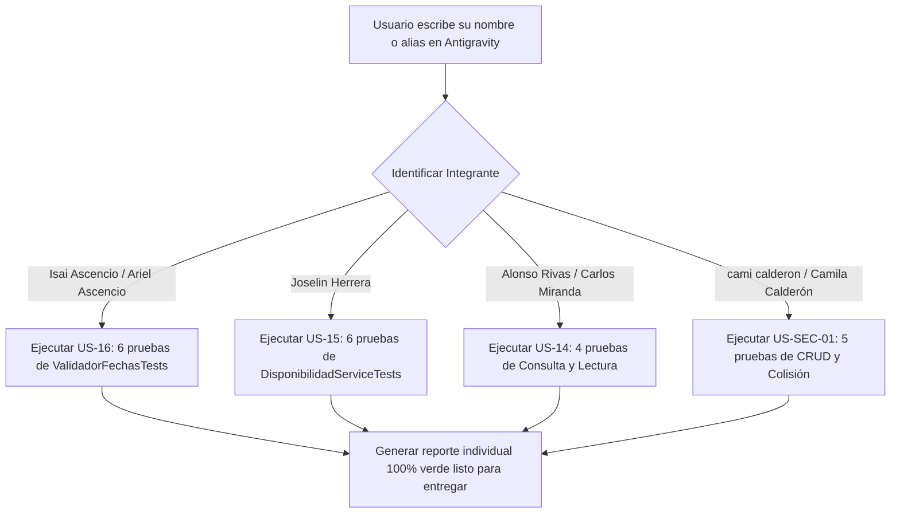

# Guía de Asignación Individual y Automatización en Antigravity

**Proyecto:** Sistema de Reserva Hotel  
**Fecha de Elaboración:** Octubre 2026  
**Referencia del Proyecto en Azure DevOps:** Test Plan #1054 — Sprint 1  
**Total de Integrantes:** 4 miembros  
**Total de Pruebas Unitarias:** 21 pruebas (100% independientes y superadas)  

---

## 🎯 Instrucción Rápida de Uso en Antigravity

> [!IMPORTANT]
> **¿Cómo usar este archivo con Antigravity?**  
> Cuando cualquier integrante del equipo abra este proyecto en **Antigravity**, solo debe escribir en el chat su **nombre completo o nombre registrado en Azure DevOps**.  
>  
> **Nombres y alias válidos en el chat:**
> * `Isai Ascencio` (o `Ariel Ascencio`, `Ariel Isai Ascencio Ramos`)
> * `Joselin Herrera` (o `Joselin Esmeralda Herrera Flores`)
> * `Alonso Rivas` (o `Carlos Miranda`, `Carlos Alonso Miranda Rivas`)
> * `cami calderon` (o `Camila Calderón`, `Camila Antonia Calderón Cortez`)
>  
> Al recibir el nombre o alias, Antigravity identificará automáticamente su historia asignada, ejecutará únicamente sus pruebas con `dotnet test` y le generará su reporte individual de evidencias en verde (100% superado), listo para entregar al profesor o ingeniero sin depender de los demás.

---

## 1. Matriz General de Asignación Individual (Azure DevOps)

| # | Integrante | Rol en QA | Historia Asignada en Azure | Test Cases Azure DevOps | Módulo / Archivo Asignado | Cantidad de Pruebas |
|:---:|:---|:---|:---|:---:|:---|:---:|
| 1 | **Ariel Isai Ascencio Ramos** (`Isai Ascencio`) | Tester de Reglas Cronológicas | **US-16 (#1040):** Validación de fechas y reglas de calendario | TC-05 (#1050) | `ValidadorFechasTests.cs` | **6 pruebas** |
| 2 | **Joselin Esmeralda Herrera Flores** (`Joselin Herrera`) | Analista de Inventario | **US-15 (#1037):** Disponibilidad por fechas y estado de inventario | TC-03 (#1048)<br>TC-04 (#1049) | `DisponibilidadServiceTests.cs` | **6 pruebas** |
| 3 | **Carlos Alonso Miranda Rivas** (`Alonso Rivas`) | Tester de Consultas y Lectura | **US-14 (#1034):** Consulta de reservas por día y por ID | TC-01 (#1046)<br>TC-02 (#1047) | Consultas en `ReservaPublicaServiceTests.cs` | **4 pruebas** |
| 4 | **Camila Antonia Calderón Cortez** (`cami calderon`) | Tester de Mutación y Persistencia | **US-SEC-01 (#1043):** Ciclo de vida CRUD y control de colisión | TC-07 (#1052)<br>TC-08 (#1053) | Comandos y Validación en `ReservaPublicaServiceTests.cs` | **5 pruebas** |
| **TOTAL** | **4 Integrantes** | — | **4 PBIs Autónomos** | **8 Casos de Test Plan** | **Lógica de Negocio (.Business)** | **21 Pruebas** |

---

## 2. Detalle y Comandos de Ejecución Individual

---

### 👤 Integrante 1: Ariel Isai Ascencio Ramos (`Isai Ascencio`)
* **Historia asignada:** **US-16 (#1040)** — *Validación de rango de fechas y reglas cronológicas de reserva*.
* **Casos del Test Plan:** TC-05 (#1050).
* **Archivo:** `SistemaReservaHotel.UnitTests/ValidadorFechasTests.cs`
* **Pruebas asignadas (6 pruebas):**
  1. `FechasValidas_EntradaFuturaYMenorQueSalida_RetornaTrue` (Rango futuro válido).
  2. `FechasValidas_EntradaHoyYSalidaManana_RetornaTrue` (Check-in inmediato de 1 noche).
  3. `FechasValidas_EntradaMayorQueSalida_RetornaFalse` (Rechaza rango invertido).
  4. `FechasValidas_EntradaIgualASalida_RetornaFalse` (Rechaza estancia de 0 noches).
  5. `FechasValidas_EntradaEnElPasado_RetornaFalse` (Bloquea check-in en el pasado).
  6. `FechasValidas_EntradaYSalidaEnElPasado_RetornaFalse` (Bloquea fechas caducadas).
* **Comando que ejecuta Antigravity:**
  ```powershell
  dotnet test SistemaReservaHotel0/SistemaReservaHotel/SistemaReservaHotel.UnitTests/SistemaReservaHotel.UnitTests.csproj --filter "FullyQualifiedName~ValidadorFechasTests"
  ```

> [!NOTE]
> Ariel ejecuta **exclusivamente** las 6 pruebas de `ValidadorFechasTests`. No depende de ningún otro integrante para entregar sus evidencias.

---

### 👤 Integrante 2: Joselin Esmeralda Herrera Flores (`Joselin Herrera`)
* **Historia asignada:** **US-15 (#1037)** — *Disponibilidad de habitaciones por rango de fechas y estado de inventario*.
* **Casos del Test Plan:** TC-03 (#1048), TC-04 (#1049).
* **Archivo:** `SistemaReservaHotel.UnitTests/DisponibilidadServiceTests.cs`
* **Pruebas asignadas (6 pruebas):**
  1. `ObtenerDisponiblesAsync_SinReservas_RetornaTodasLasHabitacionesActivas` (Hotel vacío: 100% disponibilidad).
  2. `ObtenerDisponiblesAsync_HabitacionInactiva_NoSeIncluyeEnDisponibles` (Habitaciones de baja quedan fuera).
  3. `ObtenerDisponiblesAsync_ConReservaActivaEnConflicto_ExcluyeHabitacionOcupada` (Habitación con reserva activa es excluida).
  4. `ObtenerDisponiblesAsync_ConReservaCanceladaEnMismoRango_NoExcluyeHabitacion` (Reserva cancelada libera la habitación).
  5. `ObtenerDisponiblesAsync_ReservaFinalizaElMismoDiaDeEntrada_HabitacionDisponible` (Check-out el mismo día de check-in: permitida).
  6. `ObtenerDisponiblesAsync_ReservaIniciaElMismoDiaDeSalida_HabitacionDisponible` (Check-out coincide con inicio de siguiente reserva: permitida).
* **Comando que ejecuta Antigravity:**
  ```powershell
  dotnet test SistemaReservaHotel0/SistemaReservaHotel/SistemaReservaHotel.UnitTests/SistemaReservaHotel.UnitTests.csproj --filter "FullyQualifiedName~DisponibilidadServiceTests"
  ```

> [!NOTE]
> Joselin ejecuta **exclusivamente** las 6 pruebas de `DisponibilidadServiceTests`. No depende de ningún otro integrante para entregar sus evidencias.

---

### 👤 Integrante 3: Carlos Alonso Miranda Rivas (`Alonso Rivas`)
* **Historia asignada:** **US-14 (#1034)** — *Consulta de reservas por día seleccionado y recuperación por ID*.
* **Casos del Test Plan:** TC-01 (#1046), TC-02 (#1047).
* **Archivo:** `SistemaReservaHotel.UnitTests/ReservaPublicaServiceTests.cs` (métodos de lectura/consulta)
* **Pruebas asignadas (4 pruebas):**
  1. `ObtenerPorDiaAsync_RetornaReservasDelDiaIndicado` (Criterio clave US-14: listar reservas del día seleccionado).
  2. `ObtenerTodasAsync_RetornaListaDeReservas` (Recuperar la colección global de reservas).
  3. `ObtenerPorIdAsync_IdExistente_RetornaReserva` (Búsqueda exitosa de reserva por clave primaria).
  4. `ObtenerPorIdAsync_IdInexistente_RetornaNull` (Control de errores: retorna null cuando no existe el ID).
* **Comando que ejecuta Antigravity:**
  ```powershell
  dotnet test SistemaReservaHotel0/SistemaReservaHotel/SistemaReservaHotel.UnitTests/SistemaReservaHotel.UnitTests.csproj --filter "FullyQualifiedName~ObtenerPorDiaAsync|FullyQualifiedName~ObtenerTodasAsync|FullyQualifiedName~ObtenerPorIdAsync"
  ```

> [!NOTE]
> Carlos ejecuta **exclusivamente** las 4 pruebas de consulta y lectura de `ReservaPublicaServiceTests`. No depende de ningún otro integrante para entregar sus evidencias.

---

### 👤 Integrante 4: Camila Antonia Calderón Cortez (`cami calderon`)
* **Historia asignada:** **US-SEC-01 (#1043)** — *Ciclo de vida CRUD de reservas y control de colisión de disponibilidad*.
* **Casos del Test Plan:** TC-07 (#1052), TC-08 (#1053).
* **Archivo:** `SistemaReservaHotel.UnitTests/ReservaPublicaServiceTests.cs` (métodos de escritura y validación)
* **Pruebas asignadas (5 pruebas):**
  1. `ReservarAsync_CreaReservaYRetornaEntidad` (Persistencia transaccional de nueva reserva con ID generado).
  2. `ActualizarAsync_LlamaMetodoActualizarDelRepositorio` (Modificación de estados y datos de reserva).
  3. `EliminarAsync_LlamaMetodoEliminarDelRepositorio` (Baja de reserva por ID).
  4. `ValidarDisponibilidadAsync_CuandoEstaDisponible_RetornaTrue` (Valida habitación libre antes de reservar).
  5. `ValidarDisponibilidadAsync_CuandoNoEstaDisponible_RetornaFalse` (Detecta colisión y bloquea sobreventa).
* **Comando que ejecuta Antigravity:**
  ```powershell
  dotnet test SistemaReservaHotel0/SistemaReservaHotel/SistemaReservaHotel.UnitTests/SistemaReservaHotel.UnitTests.csproj --filter "FullyQualifiedName~ReservarAsync|FullyQualifiedName~ActualizarAsync|FullyQualifiedName~EliminarAsync|FullyQualifiedName~ValidarDisponibilidadAsync"
  ```

> [!NOTE]
> Camila ejecuta **exclusivamente** las 5 pruebas de mutación y validación de colisión de `ReservaPublicaServiceTests`. No depende de ningún otro integrante para entregar sus evidencias.

---

## 3. Verificación de Cobertura Total (Sin Traslapes ni Huecos)

| Prueba Unitaria | Suite | Integrante Asignado |
|:---|:---:|:---|
| `FechasValidas_EntradaFuturaYMenorQueSalida_RetornaTrue` | ValidadorFechas | **Ariel** |
| `FechasValidas_EntradaHoyYSalidaManana_RetornaTrue` | ValidadorFechas | **Ariel** |
| `FechasValidas_EntradaMayorQueSalida_RetornaFalse` | ValidadorFechas | **Ariel** |
| `FechasValidas_EntradaIgualASalida_RetornaFalse` | ValidadorFechas | **Ariel** |
| `FechasValidas_EntradaEnElPasado_RetornaFalse` | ValidadorFechas | **Ariel** |
| `FechasValidas_EntradaYSalidaEnElPasado_RetornaFalse` | ValidadorFechas | **Ariel** |
| `ObtenerDisponiblesAsync_SinReservas_RetornaTodasLasHabitacionesActivas` | Disponibilidad | **Joselin** |
| `ObtenerDisponiblesAsync_HabitacionInactiva_NoSeIncluyeEnDisponibles` | Disponibilidad | **Joselin** |
| `ObtenerDisponiblesAsync_ConReservaActivaEnConflicto_ExcluyeHabitacionOcupada` | Disponibilidad | **Joselin** |
| `ObtenerDisponiblesAsync_ConReservaCanceladaEnMismoRango_NoExcluyeHabitacion` | Disponibilidad | **Joselin** |
| `ObtenerDisponiblesAsync_ReservaFinalizaElMismoDiaDeEntrada_HabitacionDisponible` | Disponibilidad | **Joselin** |
| `ObtenerDisponiblesAsync_ReservaIniciaElMismoDiaDeSalida_HabitacionDisponible` | Disponibilidad | **Joselin** |
| `ObtenerPorDiaAsync_RetornaReservasDelDiaIndicado` | ReservaPublica | **Carlos** |
| `ObtenerTodasAsync_RetornaListaDeReservas` | ReservaPublica | **Carlos** |
| `ObtenerPorIdAsync_IdExistente_RetornaReserva` | ReservaPublica | **Carlos** |
| `ObtenerPorIdAsync_IdInexistente_RetornaNull` | ReservaPublica | **Carlos** |
| `ReservarAsync_CreaReservaYRetornaEntidad` | ReservaPublica | **Camila** |
| `ActualizarAsync_LlamaMetodoActualizarDelRepositorio` | ReservaPublica | **Camila** |
| `EliminarAsync_LlamaMetodoEliminarDelRepositorio` | ReservaPublica | **Camila** |
| `ValidarDisponibilidadAsync_CuandoEstaDisponible_RetornaTrue` | ReservaPublica | **Camila** |
| `ValidarDisponibilidadAsync_CuandoNoEstaDisponible_RetornaFalse` | ReservaPublica | **Camila** |
| **TOTAL: 21 pruebas** | — | 6 + 6 + 4 + 5 = **21 ✅** |

---

## 4. Diagrama de Flujo Operativo en Antigravity



---

## 5. Directiva Operativa para Antigravity (Reglas del Asistente)

### Comportamiento Automático Requerido:
Cuando un usuario envíe su nombre completo, alias o fragmento de nombre reconocible:

1. **Identificar:** Localizar cuál de los 4 integrantes es según la Sección 1 (incluidos los alias del chat).
2. **Confirmar Perfil:** Saludar al integrante por su nombre, indicarle su rol, su historia de usuario asignada en Azure DevOps y los test cases correspondientes.
3. **Ejecutar Pruebas Individualmente:** Ejecutar de inmediato el comando `dotnet test` filtrado exacto de su sección, sin mezclar pruebas de otros integrantes.
4. **Presentar Evidencia:** Desglosar cada prueba que pasó con su nombre, objetivo y resultado (`Superado: 100%`).
5. **Entregar Mensaje Final:** Redactar un párrafo formal listo para que el integrante copie y envíe a su ingeniero o profesor como evidencia de su trabajo individual completado.

> [!IMPORTANT]
> **Principio de Independencia Total:** Ningún integrante debe esperar a otro, ejecutar pruebas ajenas ni depender de entregas externas. Cada uno ejecuta únicamente el filtro `dotnet test` de su propia sección y genera su propio reporte. Las 21 pruebas están distribuidas de forma que la suma es exactamente 6 + 6 + 4 + 5 = 21, sin traslapes ni huecos.
